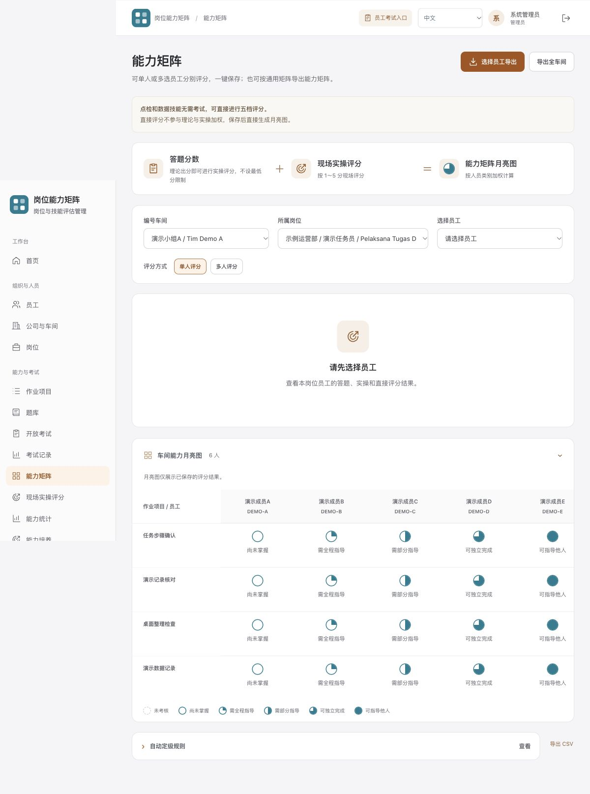

# 岗位能力矩阵 · Competency Matrix

一个可在本机运行的岗位能力评估系统：维护岗位与技能、管理双语题库、组织在线考试、记录现场实操和直接评分，再生成五级月亮能力矩阵及培养清单。

使用 Python 标准库、SQLite 和原生 JavaScript，无需安装第三方 Python 包。界面支持中文和印尼语。当前版本为通用开源演示版。

下图全部使用虚构教学数据：




## 快速开始

需要 Python 3.11 或更新版本。下载本仓库后，在项目目录运行：

```bash
python3 scripts/seed_demo.py
python3 server.py
```

Windows 可将 `python3` 改为 `py -3`。

- 管理入口：[http://127.0.0.1:8897/login](http://127.0.0.1:8897/login)
- 员工入口：[http://127.0.0.1:8897/exam](http://127.0.0.1:8897/exam)
- 首次管理员账号及随机密码：打开运行后生成的 `runtime/initial-admin.json` 查看。

示例数据完全虚构，由 `scripts/seed_demo.py` 从零生成。演示成员 A–E 展示五档评估结果；成员 F 用于体验报名和考试；成员 G 位于另一个小组，用于展示权限隔离。所有演示工号以 `DEMO-` 开头，题目均为通用教学示例。

再次运行种子脚本不会覆盖已经修改的演示记录；如果发现未知业务数据，脚本会拒绝混入示例。不运行种子脚本，直接启动 `server.py`，即可从空白业务目录开始配置。

## 主要功能

- 组织、小组、岗位和技能管理；按范围分配管理员及评分权限。
- 岗位关联共用题库，支持中文与印尼语；单选、多选、判断题自动评分。
- 支持文字型 DOCX、粘贴文字和 JSON 导入；预览确认后作为草稿保存。
- 考试轮次、报名、倒计时、答案自动保存、重复窗口和切屏提示。
- 理论成绩与现场实操分别记录，再按配置合成等级；无需考试的技能可直接评分。
- 五级月亮矩阵、评估依据、评分历史、培养清单和 CSV/XLSX 导出。
- 随机首次管理员密码、scrypt 密码校验、角色与小组权限、登录限流、静态资源白名单。

系统只保留密码校验值，不提供读取用户原密码的功能。题库标准答案通过权限校验后访问；员工答卷使用考试入口和客户端绑定进行校验。

## 演示规则

评分口径位于 `reference/rating_rules.json`。示例类别 A/B 均使用理论 50%＋实操 50%；实操为 1–5 分，五级结果为 0–4。这里的数值只是可配置示例，实际使用前应确定岗位标准、评估方法和考评员确认流程。

理论成绩、现场实操和直接观察评分分开保存。缺失证据显示待评估，不自动填充成绩。培养清单使用可比较人员的有效记录，样本不足时明确提示。

矩阵工作簿及月亮图由代码生成，默认不依赖任何外部 Office 模板。导入页可下载文字示例，再复制到“粘贴题目”；DOCX 导入支持结构明确的文字题目。

## 数据与运行范围

运行数据固定保存在当前项目的 `runtime/`；不会继承其他系统的数据库环境变量，也不自动导入已有数据。该目录、首次管理员凭据、日志、导出及备份均不属于仓库内容。

默认只监听 `127.0.0.1`。本仓库提供本机演示和可自行扩展的源码；用于多人或互联网服务时，需要另行完成 HTTPS、访问控制、容量验证和备份恢复配置。浏览器切屏提示不能从操作系统层面阻止切换应用。

可用 `python3 server.py --help` 查看启动参数，用 `Ctrl+C` 停止服务。

## 验证与代码结构

```bash
python3 -m unittest discover -s tests -v
```

测试使用临时合成数据库和随机本机端口，不依赖现有运行资料，覆盖初始化、重启、考试与实操链路、五级矩阵、直接评分、权限及生成式导出。

| 文件 | 用途 |
| --- | --- |
| `server.py` | HTTP、认证、业务 API 与持久化 |
| `exam_rounds.py` / `exam_readiness.py` | 轮次、报名范围和题库准备检查 |
| `shared_question_banks.py` / `question_document_import.py` | 共用题库与题目导入 |
| `direct_assessments.py` / `capability_development.py` | 直接评分与培养分析 |
| `workshop_xlsx.py` / `template_xlsx.py` | 从代码生成矩阵工作簿 |
| `static/` | 本机前端及明确允许公开的资源 |
| `scripts/seed_demo.py` | 可重复运行的虚构演示数据 |

## 许可

主项目采用 [MIT License](LICENSE)。JSZip 的归属及许可证见 [THIRD_PARTY_NOTICES.md](THIRD_PARTY_NOTICES.md)。
